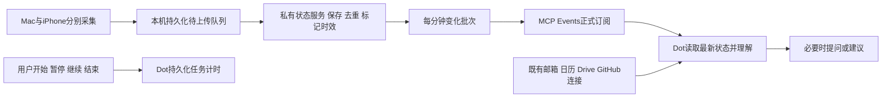

# Dot 个人状态接入：已批准决策与实施进度

更新：2026-10-05。

Jason 已批准开始接入，现有 BetterCalendar 只作为临时采集伴随 App。主入口改为 Dot 对话，不要求在 BetterCalendar 按开始或暂停。

最新决策覆盖早先“只向Dot推送有意义变化”的建议：**按分钟发送所有已收到且发生变化的状态；Dot静默阅读后再决定是否向用户提问或建议**。没有变化不产生新批次。分析触发与用户通知分别控制。

## 已完成

- 独立私有接收服务已上线：https://jason-state-bridge.jason25417.chatgpt.site 。当前账号以外不可访问；MCP工具和事件发现已发布。
- 观察带设备ID、来源、schemaVersion、递增sequence、原发生时间、服务器收到时间及有效期。重复事件不重复记账，旧数据不覆盖新状态。
- Mac/iPhone采集和快捷指令入口已发布0.65.3 (160)；Mac多目录补充0.65.4 (161)已VALID、IN_BETA_TESTING；来源方法、各平台限制和设置步骤见 [StateBridge说明](../StateBridge/README.md)。
- 开始/暂停/继续/结束计时独立持久化；暂停段不累计。用户说明、原始线索、推断分别存储，用户纠正保留历史。
- 合成事件确认正式服务已接收并生成分钟批次。SQLite核心测试通过；Mac现有238项测试通过；iOS Simulator build通过。
- 已向Dot交接工具与订阅合同，并提供「个人状态接入」插件连接入口。

## 当前连接与待验收

- 用户已安装插件，正式读取成功。16:07 UTC修复Worker redirect兼容性后，state.minute_changed订阅建立并完成挑战验证；有效期至2026-10-12 16:07:59 UTC，自动续约另验收。
- 16:10 UTC自动测试事件完成读取/理解/acknowledge_batch，全链路已验证；单次服务接收约1.7秒、模型处理约70秒。仍只有合成来源，真实设备采集、OS权限与持续延迟另验收。
- 当前Computer Use明确未获准访问BetterCalendar，文件系统全访问不替代应用操作权限；需用户开放该App访问或自行完成设备设置。当前设备列表只有关闭的模拟器，未检测到可访问的真实iPhone；需真机连接并解锁后取得安装App清单。
- Computer History 当前stopped；resume工具明确要求先在Codex Settings启用。既有观察默认全部允许，本轮未改设置或读取键盘/AX正文。
- iOS后台采集频率由系统决定，HomeKit后台通知/远程中枢、FP2桌/床区域身份、手机自动化均需真机验收。
- 当前分钟汇总由在线Mac的60秒循环及手机事件触发，没有独立云端一分钟调度器。所有设备都离线时不保证每分钟唤醒；读状态时立即标记过期。
- 邮箱、云日历、Drive、GitHub由Dot复用既有连接，未另建全文复制库，不保证每个连接都支持一分钟事件。

## 覆盖范围的追加确认

Jason要求iPhone覆盖所有游戏、社交、工作学习与常用App，具体名单由开发侧整理；不能把授权当作iOS提供全局App使用流。手机连接Mac并解锁后可先读取已安装清单，个人自动化仍需在每台手机设置，未把一组应用的打开事件误报为已知道具体App。

文件范围由开发侧选择，已确认目录存在：`~/Agent/Personal Study`、`~/Developer`、`~/Documents`、`~/Desktop`、`~/Downloads`。只采集相关文件的名称/修改时间，排除缓存、依赖、凭据和系统目录。161已实现多目录递归、分轮继续扫描与覆盖状态报告，兼容160的单目录配置。仍需实际选择目录并收到真实数据才算接通；不采集正文，也不宣称每个文件变化都会在一分钟内遍历到。

## 行为与历史约定

- 用户说开始才开始显式任务计时，传感器缺少活动不会自动暂停/完成任务。计时保存成功才确认。
- 有证据的自动记录标inferred，并写依据/把握程度/时间范围；不确定只有在会影响记录或建议时才简短问。不要把未知时段强行填满。
- 普通主动建议克制，默认每日最多两条；用户求助与明确固定约定按用户需求处理。没有deadline的愿望可以成为候选，不因收到了邀请就变成义务。
- 私人生活记录长期保留；主动删除30天恢复是此前约定。本轮没有增加删除接口或自动清理策略。
- 新接入与SwiftData/CloudKit旧业务数据库解耦，无需新CloudKit schema部署。

## 平台依据

- [MCP Events](https://developers.openai.com/plugins/build/mcp-events)：正式订阅、挑战验证、签名、异步回调和续约。
- [HealthKit observer](https://developer.apple.com/documentation/healthkit/executing-observer-queries)：健康变化及后台更新依系统调度。
- [EventKit访问](https://developer.apple.com/documentation/EventKit/accessing-the-event-store)：日历/提醒事项原生权限。

每项数据以“代码实现／系统已授权／收到真实数据／Dot已处理”分别验收，最后以用户实际不用手动维护记录而得到有用建议为准。

## 2026-10-05 18:00 UTC 设备设置交接

Jason已取得并提供iPhone设备配置，服务确认该设备登记；目前尚无真实iPhone观察。只在App粘贴保存、启用并接受OS权限后才开始采集。用户当前只有手机，其余Mac权限等回到电脑操作。

Cloudflare复用Sotto/Scritto的现有账号；本机Wrangler仍未登录，因此独立分钟clock未部署。clock已用无个人来源权限的独立设备登记，连接配置以0600留在本机Application Support，不入Git/记忆；凭据不在本报告重复。

## 2026-10-05 22:44 EDT 当前核验

iPhone已收到真实数据，两个事件批次都完成Dot处理回执。手机连接阶段已通过；后台更新节奏、低置信传感器区域身份和手机App自动化仍按原清单验收。

Computer Use浏览器可操作；Computer History录制状态stopped，事件文件停在11:40 EDT，不能据此断定用户未启用开关。观察规则已为全部observe，未擅自改设置。需要检查录制运行状态；Codex自身设置页由工具自身保护禁止操作。Cloudflare浏览器和CLI均未登录，但网页有原有Apple账号profile；复用现有账号的决定保持，等待恢复本机登录。

健康查询成功后清除旧失败状态的源码修复已通过iOS Simulator build；手机160暂未包含，当前应依据更新的实际来源区分过去的失败，不把health.status旧错误当作持续授权失败。
